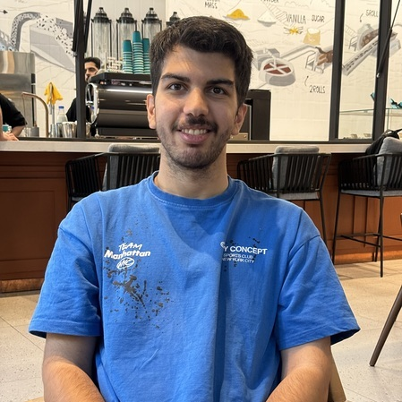



**
{: .collab-affil}

<dl class="collab-details">
<dt>Date</dt><dd>{{ include.date }}</dd>
<dt>Co-supervisor</dt><dd>{{ include.cosupervisor | markdownify | remove: '
' | remove: '
' | strip }}</dd>
<dt>Project</dt><dd>{{ include.project }}</dd>
</dl>

- {: .pub-preprint} [Strongly enstrophy-stable integrators for the incompressible Navier–Stokes equations](/publications/enstrophy/)
{: .collab-pubs}