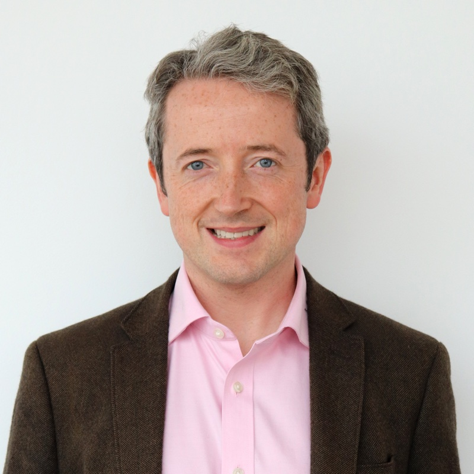



* / *
{: .collab-affil}

<!-- - **Role** <code>&#124;</code> PhD (DPhil) co-supervisor -->

- [Enforcing conservation laws and dissipation inequalities numerically via auxiliary variables](/publications/sp-integrators-a/)
- [Helicity-preserving finite element discretization for magnetic relaxation](/publications/parker/)
- [Conservative and dissipative discretisations of multi-conservative ODEs and GENERIC systems](/publications/sp-integrators-b/)
- [Arbitrary-order structure-preserving discretizations for geometric curvature flows](/publications/geometric-flows/)
- [Automated Galerkin time stepping in Irksome](/publications/irksome-galerkin/)
- [Strongly enstrophy-stable integrators for the incompressible Navier–Stokes equations](/publications/enstrophy/)
- [Structure-preserving discretisations for the quasi-incompressible, thermal Maxwell–Stefan equations](/publications/stefan-maxwell/)
- Arbitrary-order energy-stable discretizations of viscoelastic fluids*
{: .collab-pubs}